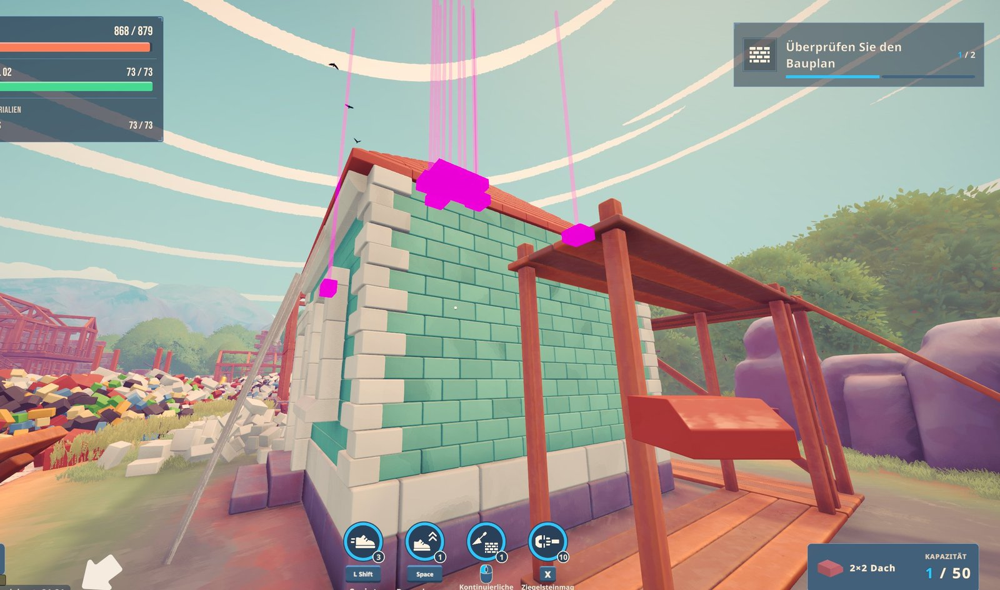
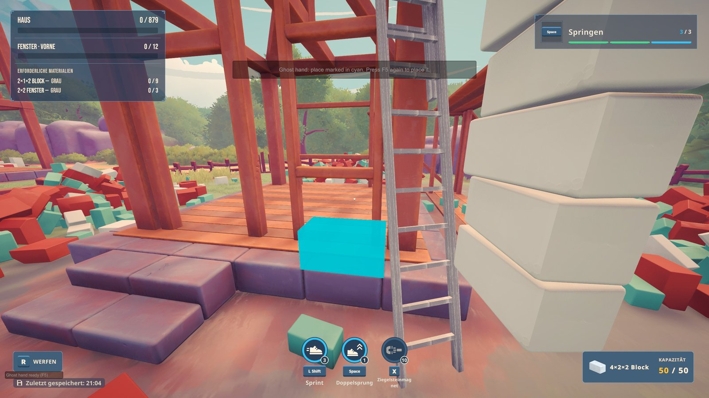
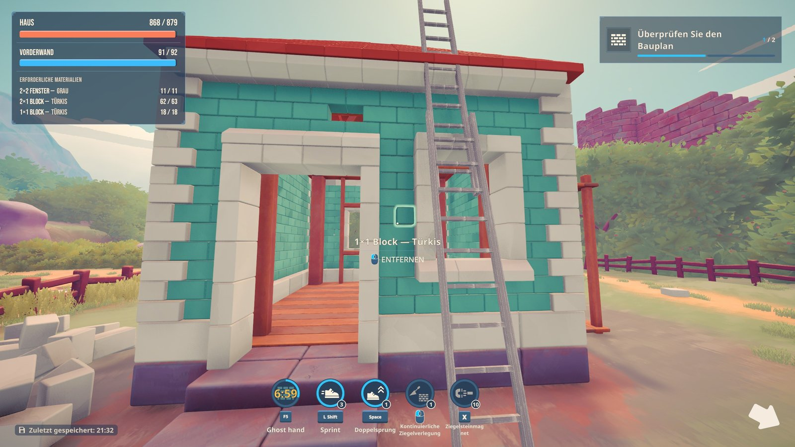

# Brick by Brick – BuildHelper (Mod)

Two helpers for the last bricks of a building, in every world (the town's buildings as well as
[Extra Buildings](https://github.com/michel86ch-ui/brickbybrick-mod) like the Taj Mahal):

- **F8 – missing bricks:** shows every empty brick place of the sites with only a few left, in magenta, through walls.
- **F5 – ghost hand:** places the brick you carry into a place you cannot reach by hand, for example behind a wall or
  inside a niche. Once every 10 minutes.

> Unofficial fan mod, not made by the game's developers. A world in which the ghost hand placed a brick no longer counts
> for the Steam leaderboard (the mod marks it as practice). Showing the missing bricks alone changes nothing.



*F8 on a house with 11 bricks missing (868 / 879): each empty place in magenta, seen through the roof, with a line upwards.*



*F5: the free place for the carried brick is marked in cyan; F5 again places it.*



*After a brick placed by ghost hand: the countdown in the skill bar, left of sprint.*

## Install

1. Download **[buildhelper-mod.zip](https://github.com/michel86ch-ui/brickbybrick-mod-buildhelper/raw/main/buildhelper-mod.zip)**. Tested with the game update of 9 November 2026.
2. Unzip everything into the game folder, so that `winhttp.dll` sits next to `BrickByBrick.exe`
   (Steam: right-click the game > Manage > Browse local files). BepInEx already installed (e.g. with
   [Extra Buildings](https://github.com/michel86ch-ui/brickbybrick-mod) or the
   [Ladder](https://github.com/michel86ch-ui/brickbybrick-mod-ladder))? Just overwrite, the files are the same.

Settings: `BepInEx\config\michel.brickbybrick.buildhelper.cfg` (created at the first game start).
Uninstall: delete the folder `BepInEx\plugins\BuildHelper`.

The ZIP contains BepInEx 5.4.23.5 (unmodified, MIT license) and the mod.

## How to use

**F8 – missing bricks** (press again to hide)

- Sites with up to 50 bricks missing: every empty place as a magenta box, drawn through walls and roofs, with a 6 m
  line upwards so you find it from afar. A box disappears as soon as its brick is set.
- Sites with more missing bricks are only counted in the message at the top (`Limit` in the settings, 1–2000).

**F5 – ghost hand**

1. Carry the brick and look towards its place; walls in between do not matter.
2. **F5** marks the place in cyan.
3. **F5** again within 5 seconds places the brick there.

The ghost hand only offers places the game itself would accept the brick in: free, with the bricks below already in
place, the right brick (shape and colour), you inside the site and within the normal reach. It never puts a wrong brick
behind a wall, where you could not take it out again.

After a brick placed by ghost hand you wait 10 minutes (`CooldownMinutes`). The countdown is a round icon in the skill
bar, left of sprint. The waiting time only starts when the game has taken the brick.

## Good to know

- Leaderboard: the first brick placed by ghost hand marks the world as practice (in a world you host). The message after
  the first F5 says so before you confirm.
- The ghost hand uses the game's own placement request, so the game checks the placement as usual. Tested in single
  player.
- The waiting time counts in real time across all worlds, also while the game is closed (`LastUse` in the settings).
- Only you see the markers.
- Keys, `Limit`, `CooldownMinutes` and `ShowTimer` (the icon in the skill bar) are in the settings file.

## Building

```
cd src
dotnet build -c Release -p:DeployToGame=true     (copies the DLL into the game)
```

The markers use the game's UI/Default shader with its depth test set to Always, so nothing hides them. The ghost hand
selects the place itself and then calls the game's placement code for it, as if you had aimed at it.
